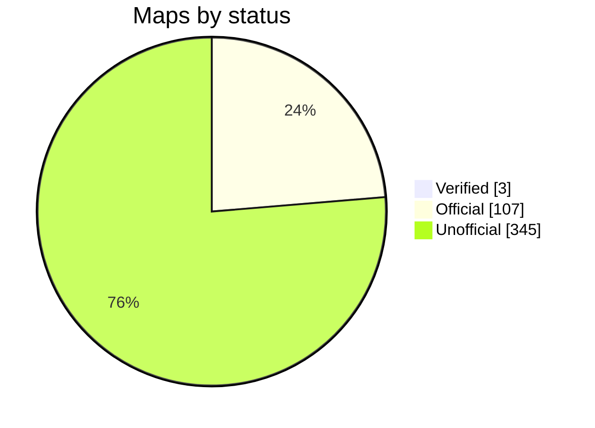

<p align="center">
  <picture>
    <source media="(prefers-color-scheme: dark)" srcset="assets/mbmap-logo-white.svg">
    
  </picture>
</p>

# mbmap-library

[](https://github.com/nobrega8/mbmap-library/actions/workflows/validate.yml)
[](index.json)
[](maps)
[](SPEC.md)
[](https://doi.org/10.5281/zenodo.23439922)
[](LICENSE)
[](CONTRIBUTING.md)
[](https://ko-fi.com/nobrega)

An open library of Modbus register maps in the [`.mbmap` format](SPEC.md), a JSON format with a [JSON Schema](schema/mbmap-2.schema.json).

Each file describes one device model: the manufacturer, how to connect to it and what every register means. Load a map into a compatible tool and you get the device's variables, already named, scaled and typed, without typing addresses from a PDF manual.

## Layout

```text
SPEC.md                           the .mbmap format specification
schema/mbmap-2.schema.json        its JSON Schema
COMPATIBILITY.md                  tools that read the format, and what each supports
maps/<vendor>/<model>.mbmap.json  the shared maps
examples/                         fictional maps that show the format
index.json                        list of the maps, for apps that browse the library
tools/export/                     exports a map to other software (Ignition)
tests/                            sample files and the diagnostics each must produce,
                                  for checking any .mbmap reader against the spec
```

Folder and file names are lowercase slugs, e.g. `maps/acme-meters/pm-200.mbmap.json`.

## Map status

The maps in this library say how far they can be trusted in `x_status`. It is not part of the mbmap format, just an optional key that this library and Modbench read:

- **`verified`**: tested on a real device.
- **`official`**: written from the manufacturer's documentation (named in `source`), but not tested on a device yet.
- **`unofficial`**: copied from an unofficial source and not tested. A large part of the library was **converted from other open catalogues** of Modbus tables to get everyone started. Nobody has checked these against the manufacturer's documentation yet, and some details (byte order, which register area, scaling) may be wrong. Read them as a draft and check a value on the real device before you rely on the rest.

<!-- status-chart:start -->

<!-- status-chart:end -->

Tested a map on your device? Tell us in a pull request or a [test report](https://github.com/nobrega8/mbmap-library/issues/new?template=1-test-report.yml), even if you did not write the map.

Corrections are the most useful contribution: see [CONTRIBUTING.md](CONTRIBUTING.md). Questions and ideas go to [Discussions](https://github.com/nobrega8/mbmap-library/discussions).

## Using the maps

A map is a JSON file with one register per line, so it reads well in any text editor and any language can load it with its JSON parser; editors that support JSON Schema check it as you type.

[COMPATIBILITY.md](COMPATIBILITY.md) lists the tools that read the format and which parts of it each one supports. The main one is [Modbench](https://github.com/nobrega8/modbench), a Modbus client for Windows, Linux and macOS that browses and downloads the maps in this repository directly.

Building a tool that reads `.mbmap`? Follow [SPEC.md](SPEC.md), check it against the samples in [`tests/`](tests/), and open a pull request to add it to [COMPATIBILITY.md](COMPATIBILITY.md). Work in progress is welcome in [Show and tell](https://github.com/nobrega8/mbmap-library/discussions/categories/show-and-tell).

## Badge

A tool that reads `.mbmap` files can say so with this badge, which links here:

[![Supports .mbmap](https://img.shields.io/badge/supports-.mbmap-0A7EA4?logo=data:image/svg%2bxml;base64,PHN2ZyB4bWxucz0iaHR0cDovL3d3dy53My5vcmcvMjAwMC9zdmciIHZpZXdCb3g9IjAgMCAyNCAyNCIgZmlsbD0iI2ZmZmZmZiIgZmlsbC1ydWxlPSJldmVub2RkIj4KICA8dGl0bGU+bWJtYXA8L3RpdGxlPgogIDxnIHRyYW5zZm9ybT0idHJhbnNsYXRlKDAgLTAuNTUpIj4KICAgIDxyZWN0IHg9IjEuNDUiIHk9IjUuMyIgd2lkdGg9IjIuNiIgaGVpZ2h0PSIyLjYiIHJ4PSIwLjUiLz4KICAgIDxyZWN0IHg9IjUuOTUiIHk9IjUuMyIgd2lkdGg9IjIuNiIgaGVpZ2h0PSIyLjYiIHJ4PSIwLjUiLz4KICAgIDxyZWN0IHg9IjEwLjQ1IiB5PSI1LjMiIHdpZHRoPSIyLjYiIGhlaWdodD0iMi42IiByeD0iMC41Ii8+CiAgICA8cGF0aCBkPSJNMS41NSAxOS4zVjEyLjQ1QTMuNDUgMy40NSAwIDAgMSA3LjI1IDkuODM1QTMuNDUgMy40NSAwIDAgMSAxMi45NSAxMi40NVYxOS4zYTAuNSAwLjUgMCAwIDEtMC41IDAuNUgxMS4wNWEwLjUgMC41IDAgMCAxLTAuNS0wLjVWMTIuNDVBMS4wNSAxLjA1IDAgMCAwIDguNDUgMTIuNDVWMTkuM2EwLjUgMC41IDAgMCAxLTAuNSAwLjVINi41NWEwLjUgMC41IDAgMCAxLTAuNS0wLjVWMTIuNDVBMS4wNSAxLjA1IDAgMCAwIDMuOTUgMTIuNDVWMTkuM2EwLjUgMC41IDAgMCAxLTAuNSAwLjVIMi4wNWEwLjUgMC41IDAgMCAxLTAuNS0wLjVaIi8+CiAgICA8cGF0aCBkPSJNMTUuMDUgNS44YTAuNSAwLjUgMCAwIDEgMC41LTAuNUgxNi45NWEwLjUgMC41IDAgMCAxIDAuNSAwLjVWOUgxOUEzLjQ1IDMuNDUgMCAwIDEgMjIuNDUgMTIuNDVWMTYuMzVBMy40NSAzLjQ1IDAgMCAxIDE5IDE5LjhIMTUuNTVhMC41IDAuNSAwIDAgMS0wLjUtMC41Wk0xNy40NSAxMS40VjE3LjRIMTlBMS4wNSAxLjA1IDAgMCAwIDIwLjA1IDE2LjM1VjEyLjQ1QTEuMDUgMS4wNSAwIDAgMCAxOSAxMS40WiIvPgogIDwvZz4KPC9zdmc+Cg==)](https://github.com/nobrega8/mbmap-library)

```markdown
[![Supports .mbmap](https://img.shields.io/badge/supports-.mbmap-0A7EA4?logo=data:image/svg%2bxml;base64,PHN2ZyB4bWxucz0iaHR0cDovL3d3dy53My5vcmcvMjAwMC9zdmciIHZpZXdCb3g9IjAgMCAyNCAyNCIgZmlsbD0iI2ZmZmZmZiIgZmlsbC1ydWxlPSJldmVub2RkIj4KICA8dGl0bGU+bWJtYXA8L3RpdGxlPgogIDxnIHRyYW5zZm9ybT0idHJhbnNsYXRlKDAgLTAuNTUpIj4KICAgIDxyZWN0IHg9IjEuNDUiIHk9IjUuMyIgd2lkdGg9IjIuNiIgaGVpZ2h0PSIyLjYiIHJ4PSIwLjUiLz4KICAgIDxyZWN0IHg9IjUuOTUiIHk9IjUuMyIgd2lkdGg9IjIuNiIgaGVpZ2h0PSIyLjYiIHJ4PSIwLjUiLz4KICAgIDxyZWN0IHg9IjEwLjQ1IiB5PSI1LjMiIHdpZHRoPSIyLjYiIGhlaWdodD0iMi42IiByeD0iMC41Ii8+CiAgICA8cGF0aCBkPSJNMS41NSAxOS4zVjEyLjQ1QTMuNDUgMy40NSAwIDAgMSA3LjI1IDkuODM1QTMuNDUgMy40NSAwIDAgMSAxMi45NSAxMi40NVYxOS4zYTAuNSAwLjUgMCAwIDEtMC41IDAuNUgxMS4wNWEwLjUgMC41IDAgMCAxLTAuNS0wLjVWMTIuNDVBMS4wNSAxLjA1IDAgMCAwIDguNDUgMTIuNDVWMTkuM2EwLjUgMC41IDAgMCAxLTAuNSAwLjVINi41NWEwLjUgMC41IDAgMCAxLTAuNS0wLjVWMTIuNDVBMS4wNSAxLjA1IDAgMCAwIDMuOTUgMTIuNDVWMTkuM2EwLjUgMC41IDAgMCAxLTAuNSAwLjVIMi4wNWEwLjUgMC41IDAgMCAxLTAuNS0wLjVaIi8+CiAgICA8cGF0aCBkPSJNMTUuMDUgNS44YTAuNSAwLjUgMCAwIDEgMC41LTAuNUgxNi45NWEwLjUgMC41IDAgMCAxIDAuNSAwLjVWOUgxOUEzLjQ1IDMuNDUgMCAwIDEgMjIuNDUgMTIuNDVWMTYuMzVBMy40NSAzLjQ1IDAgMCAxIDE5IDE5LjhIMTUuNTVhMC41IDAuNSAwIDAgMS0wLjUtMC41Wk0xNy40NSAxMS40VjE3LjRIMTlBMS4wNSAxLjA1IDAgMCAwIDIwLjA1IDE2LjM1VjEyLjQ1QTEuMDUgMS4wNSAwIDAgMCAxOSAxMS40WiIvPgogIDwvZz4KPC9zdmc+Cg==)](https://github.com/nobrega8/mbmap-library)
```

## Contributing

New maps and fixes are welcome. Read [CONTRIBUTING.md](CONTRIBUTING.md), then check your file:

```sh
python tools/validate/validate.py maps/your-vendor/your-model.mbmap.json
```

## Contributors

Thanks to everyone who has added or corrected a map.

[](https://github.com/nobrega8/mbmap-library/graphs/contributors)

## License

The maps, the spec and the tools are dedicated to the public domain under [CC0 1.0](LICENSE). You can use them for anything, including commercial products, without asking or giving credit.

The maps are provided as is. Always check a map against the manufacturer's documentation before you write to a live device.

## Funding

The library is free and in the public domain. If it saves you time, you can support its development on Ko-fi:

<a href="https://ko-fi.com/nobrega"></a>
