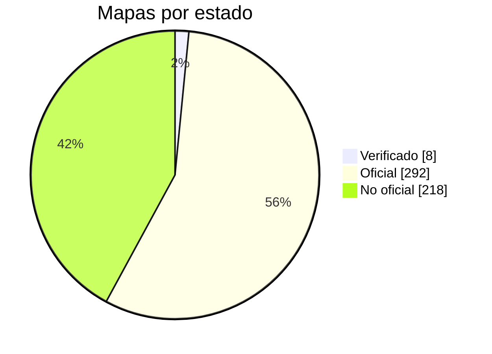

<p align="center">
  <picture>
    <source media="(prefers-color-scheme: dark)" srcset="../../assets/mbmap-logo-white.svg">
    
  </picture>
</p>

# mbmap-library

[English](../../README.md) · **Español** · [简体中文](README_ZHS.md) · [日本語](README_JP.md)

[](https://github.com/nobrega8/mbmap-library/actions/workflows/validate.yml)
[](../../index.json)
[](../../maps)
[](../../SPEC.md)
[](https://doi.org/10.5281/zenodo.23439922)
[](../../LICENSE)
[](../../CONTRIBUTING.md)
[](https://buymeacoffee.com/nobrega8)

Una biblioteca abierta de mapas de registros Modbus en el [formato `.mbmap`](../../SPEC.md), un formato JSON con un [esquema JSON](../../schema/mbmap-2.schema.json).

Explora y busca todos los mapas, sus registros y sus ajustes de conexión en el sitio web: **[nobrega8.github.io/mbmap-library](https://nobrega8.github.io/mbmap-library/)**.

Cada archivo describe un modelo de dispositivo: el fabricante, cómo conectarse a él y qué significa cada registro. Si cargas un mapa en una herramienta compatible, obtienes las variables del dispositivo ya con nombre, escaladas y tipadas, sin tener que copiar direcciones de un manual en PDF.

> Esta es una traducción del [README en inglés](../../README.md), que es la referencia y puede estar más al día.

## Estructura

```text
SPEC.md                           la especificación del formato .mbmap
schema/mbmap-2.schema.json        su esquema JSON
COMPATIBILITY.md                  herramientas que leen el formato y qué admite cada una
maps/<fabricante>/<modelo>.mbmap.json  los mapas compartidos
examples/                         mapas ficticios que muestran el formato
index.json                        lista de mapas, para las aplicaciones que exploran la biblioteca
tools/                            validador, generador del índice y otros scripts (ver tools/README.md)
tests/                            archivos de muestra y los diagnósticos que debe producir cada uno,
                                  para comprobar cualquier lector de .mbmap con la especificación
```

Los nombres de carpetas y archivos son slugs en minúsculas, p. ej. `maps/acme-meters/pm-200.mbmap.json`.

## Estado de los mapas

Los mapas de esta biblioteca indican en `x_status` hasta qué punto se puede confiar en ellos. No forma parte del formato mbmap, es solo una clave opcional que leen esta biblioteca y Modbench:

- **`verified`** (verificado): probado en un dispositivo real.
- **`official`** (oficial): escrito a partir de la documentación del fabricante (indicada en `source`), pero aún no probado en un dispositivo.
- **`unofficial`** (no oficial): copiado de una fuente no oficial y sin probar. Gran parte de la biblioteca se **convirtió desde otros catálogos abiertos** de tablas Modbus para que todos pudieran empezar. Nadie las ha comparado todavía con la documentación del fabricante, y algunos detalles (orden de bytes, área de registros, escalado) pueden ser incorrectos. Léelos como un borrador y comprueba un valor en el dispositivo real antes de fiarte del resto.

<!-- status-chart:start -->

<!-- status-chart:end -->

¿Has probado un mapa en tu dispositivo? Cuéntanoslo en un pull request o en un [informe de prueba](https://github.com/nobrega8/mbmap-library/issues/new?template=1-test-report.yml), aunque no hayas escrito el mapa.

Las correcciones son la contribución más útil: consulta [CONTRIBUTING.md](../../CONTRIBUTING.md). Las preguntas e ideas van a [Discussions](https://github.com/nobrega8/mbmap-library/discussions).

## Usar los mapas

Un mapa es un archivo JSON con un registro por línea, así que se lee bien en cualquier editor de texto y cualquier lenguaje puede cargarlo con su analizador JSON; los editores que admiten esquema JSON lo comprueban mientras escribes.

[COMPATIBILITY.md](../../COMPATIBILITY.md) enumera las herramientas que leen el formato y qué partes admite cada una. La principal es [Modbench](https://github.com/nobrega8/modbench), un cliente Modbus para Windows, Linux y macOS que explora y descarga directamente los mapas de este repositorio. [ScanBus-BR](https://github.com/ortegahernandes/ScanBus-BR-Simulator-Modbus), un simulador y sniffer Modbus para Windows y Linux, también puede buscar en la biblioteca, y [MTUI](https://github.com/inowattio/MTUI), un cliente Modbus para la terminal, importa un mapa pegado como registros con etiqueta y decodificados.

¿Estás creando una herramienta que lee `.mbmap`? Sigue [SPEC.md](../../SPEC.md), compruébala con las muestras de [`tests/`](../../tests/) y abre un pull request para añadirla a [COMPATIBILITY.md](../../COMPATIBILITY.md). El trabajo en curso es bienvenido en [Show and tell](https://github.com/nobrega8/mbmap-library/discussions/categories/show-and-tell).

## Insignia

Una herramienta que lee archivos `.mbmap` puede indicarlo con esta insignia, que enlaza aquí:

[![Supports .mbmap](https://img.shields.io/badge/supports-.mbmap-0A7EA4?logo=data:image/svg%2bxml;base64,PHN2ZyB4bWxucz0iaHR0cDovL3d3dy53My5vcmcvMjAwMC9zdmciIHZpZXdCb3g9IjAgMCAyNCAyNCIgZmlsbD0iI2ZmZmZmZiIgZmlsbC1ydWxlPSJldmVub2RkIj4KICA8dGl0bGU+bWJtYXA8L3RpdGxlPgogIDxnIHRyYW5zZm9ybT0idHJhbnNsYXRlKDAgLTAuNTUpIj4KICAgIDxyZWN0IHg9IjEuNDUiIHk9IjUuMyIgd2lkdGg9IjIuNiIgaGVpZ2h0PSIyLjYiIHJ4PSIwLjUiLz4KICAgIDxyZWN0IHg9IjUuOTUiIHk9IjUuMyIgd2lkdGg9IjIuNiIgaGVpZ2h0PSIyLjYiIHJ4PSIwLjUiLz4KICAgIDxyZWN0IHg9IjEwLjQ1IiB5PSI1LjMiIHdpZHRoPSIyLjYiIGhlaWdodD0iMi42IiByeD0iMC41Ii8+CiAgICA8cGF0aCBkPSJNMS41NSAxOS4zVjEyLjQ1QTMuNDUgMy40NSAwIDAgMSA3LjI1IDkuODM1QTMuNDUgMy40NSAwIDAgMSAxMi45NSAxMi40NVYxOS4zYTAuNSAwLjUgMCAwIDEtMC41IDAuNUgxMS4wNWEwLjUgMC41IDAgMCAxLTAuNS0wLjVWMTIuNDVBMS4wNSAxLjA1IDAgMCAwIDguNDUgMTIuNDVWMTkuM2EwLjUgMC41IDAgMCAxLTAuNSAwLjVINi41NWEwLjUgMC41IDAgMCAxLTAuNS0wLjVWMTIuNDVBMS4wNSAxLjA1IDAgMCAwIDMuOTUgMTIuNDVWMTkuM2EwLjUgMC41IDAgMCAxLTAuNSAwLjVIMi4wNWEwLjUgMC41IDAgMCAxLTAuNS0wLjVaIi8+CiAgICA8cGF0aCBkPSJNMTUuMDUgNS44YTAuNSAwLjUgMCAwIDEgMC41LTAuNUgxNi45NWEwLjUgMC41IDAgMCAxIDAuNSAwLjVWOUgxOUEzLjQ1IDMuNDUgMCAwIDEgMjIuNDUgMTIuNDVWMTYuMzVBMy40NSAzLjQ1IDAgMCAxIDE5IDE5LjhIMTUuNTVhMC41IDAuNSAwIDAgMS0wLjUtMC41Wk0xNy40NSAxMS40VjE3LjRIMTlBMS4wNSAxLjA1IDAgMCAwIDIwLjA1IDE2LjM1VjEyLjQ1QTEuMDUgMS4wNSAwIDAgMCAxOSAxMS40WiIvPgogIDwvZz4KPC9zdmc+Cg==)](https://github.com/nobrega8/mbmap-library)

```markdown
[![Supports .mbmap](https://img.shields.io/badge/supports-.mbmap-0A7EA4?logo=data:image/svg%2bxml;base64,PHN2ZyB4bWxucz0iaHR0cDovL3d3dy53My5vcmcvMjAwMC9zdmciIHZpZXdCb3g9IjAgMCAyNCAyNCIgZmlsbD0iI2ZmZmZmZiIgZmlsbC1ydWxlPSJldmVub2RkIj4KICA8dGl0bGU+bWJtYXA8L3RpdGxlPgogIDxnIHRyYW5zZm9ybT0idHJhbnNsYXRlKDAgLTAuNTUpIj4KICAgIDxyZWN0IHg9IjEuNDUiIHk9IjUuMyIgd2lkdGg9IjIuNiIgaGVpZ2h0PSIyLjYiIHJ4PSIwLjUiLz4KICAgIDxyZWN0IHg9IjUuOTUiIHk9IjUuMyIgd2lkdGg9IjIuNiIgaGVpZ2h0PSIyLjYiIHJ4PSIwLjUiLz4KICAgIDxyZWN0IHg9IjEwLjQ1IiB5PSI1LjMiIHdpZHRoPSIyLjYiIGhlaWdodD0iMi42IiByeD0iMC41Ii8+CiAgICA8cGF0aCBkPSJNMS41NSAxOS4zVjEyLjQ1QTMuNDUgMy40NSAwIDAgMSA3LjI1IDkuODM1QTMuNDUgMy40NSAwIDAgMSAxMi45NSAxMi40NVYxOS4zYTAuNSAwLjUgMCAwIDEtMC41IDAuNUgxMS4wNWEwLjUgMC41IDAgMCAxLTAuNS0wLjVWMTIuNDVBMS4wNSAxLjA1IDAgMCAwIDguNDUgMTIuNDVWMTkuM2EwLjUgMC41IDAgMCAxLTAuNSAwLjVINi41NWEwLjUgMC41IDAgMCAxLTAuNS0wLjVWMTIuNDVBMS4wNSAxLjA1IDAgMCAwIDMuOTUgMTIuNDVWMTkuM2EwLjUgMC41IDAgMCAxLTAuNSAwLjVIMi4wNWEwLjUgMC41IDAgMCAxLTAuNS0wLjVaIi8+CiAgICA8cGF0aCBkPSJNMTUuMDUgNS44YTAuNSAwLjUgMCAwIDEgMC41LTAuNUgxNi45NWEwLjUgMC41IDAgMCAxIDAuNSAwLjVWOUgxOUEzLjQ1IDMuNDUgMCAwIDEgMjIuNDUgMTIuNDVWMTYuMzVBMy40NSAzLjQ1IDAgMCAxIDE5IDE5LjhIMTUuNTVhMC41IDAuNSAwIDAgMS0wLjUtMC41Wk0xNy40NSAxMS40VjE3LjRIMTlBMS4wNSAxLjA1IDAgMCAwIDIwLjA1IDE2LjM1VjEyLjQ1QTEuMDUgMS4wNSAwIDAgMCAxOSAxMS40WiIvPgogIDwvZz4KPC9zdmc+Cg==)](https://github.com/nobrega8/mbmap-library)
```

## Contribuir

Los mapas nuevos y las correcciones son bienvenidos. Lee [CONTRIBUTING.md](../../CONTRIBUTING.md) y luego comprueba tu archivo:

```sh
python tools/validate/validate.py maps/your-vendor/your-model.mbmap.json
```

## Colaboradores

Gracias a todas las personas que han añadido o corregido un mapa.

<table>
  <tr>
    <td align="center"><a href="https://github.com/nobrega8"><br /><sub>Afonso Nóbrega</sub></a></td>
    <td align="center"><a href="https://github.com/ortegahernandes"><br /><sub>Rodrigo Hernandes</sub></a></td>
    <td align="center"><a href="https://github.com/marcosribeirobr"><br /><sub>Marcos Ribeiro</sub></a></td>
    <td align="center"><a href="https://github.com/NickHardy-Spotlight"><br /><sub>NickHardy-Spotlight</sub></a></td>
    <td align="center"><a href="https://github.com/CosminPerRam"><br /><sub>CosminPerRam</sub></a></td>
  </tr>
</table>

Esta lista incluye a quienes figuran con un tráiler `Co-authored-by`, que el gráfico de colaboradores de GitHub no cuenta.

## Licencia

Los mapas, la especificación y las herramientas están dedicados al dominio público bajo [CC0 1.0](../../LICENSE). Puedes usarlos para cualquier fin, incluidos productos comerciales, sin pedir permiso ni dar crédito.

Los mapas se proporcionan tal cual. Comprueba siempre un mapa con la documentación del fabricante antes de escribir en un dispositivo en funcionamiento.

## Financiación

La biblioteca es libre y de dominio público. Si te ahorra tiempo, puedes apoyar su desarrollo en Buy Me a Coffee:

<a href="https://buymeacoffee.com/nobrega8"></a>
