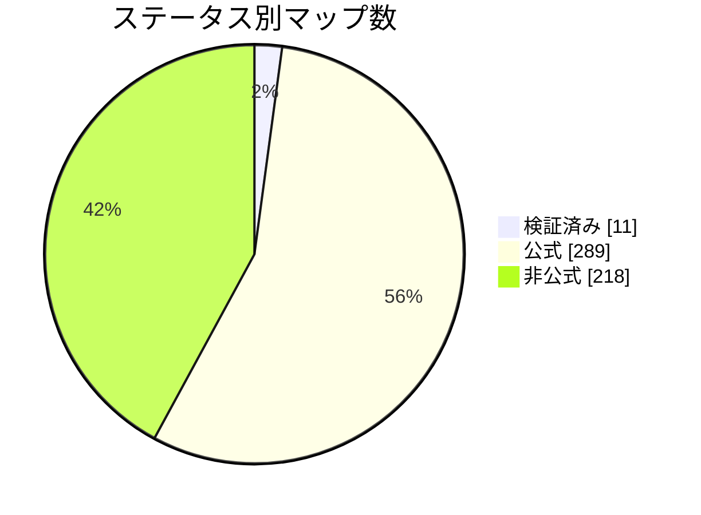

<p align="center">
  <picture>
    <source media="(prefers-color-scheme: dark)" srcset="../../assets/mbmap-logo-white.svg">
    
  </picture>
</p>

# mbmap-library

[English](../../README.md) · [Español](README_ES.md) · [简体中文](README_ZHS.md) · **日本語**

[](https://github.com/nobrega8/mbmap-library/actions/workflows/validate.yml)
[](../../index.json)
[](../../maps)
[](../../SPEC.md)
[](https://doi.org/10.5281/zenodo.23439922)
[](../../LICENSE)
[](../../CONTRIBUTING.md)
[](https://buymeacoffee.com/nobrega8)

[`.mbmap` 形式](../../SPEC.md)で書かれた Modbus レジスタマップのオープンなライブラリです。形式は JSON で、[JSON Schema](../../schema/mbmap-2.schema.json) が用意されています。

すべてのマップ、そのレジスタ、接続設定は、ウェブサイトで閲覧・検索できます：**[nobrega8.github.io/mbmap-library](https://nobrega8.github.io/mbmap-library/)**。

各ファイルは 1 つのデバイスモデルを記述します。メーカー、接続方法、各レジスタの意味です。対応ツールにマップを読み込めば、PDF マニュアルからアドレスを書き写さなくても、名前・スケーリング・型が設定済みのデバイス変数が得られます。

> これは[英語版 README](../../README.md) の翻訳です。英語版が正であり、より新しい場合があります。

## 構成

```text
SPEC.md                           .mbmap 形式の仕様
schema/mbmap-2.schema.json        その JSON Schema
COMPATIBILITY.md                  この形式を読めるツールと、それぞれの対応範囲
maps/<メーカー>/<モデル>.mbmap.json  共有マップ
examples/                         形式を示す架空のマップ
index.json                        マップの一覧（ライブラリを閲覧するアプリ向け）
tools/                            検証ツール、インデックス生成ツールなどのスクリプト（tools/README.md 参照）
tests/                            サンプルファイルと、それぞれが出すべき診断結果。
                                  任意の .mbmap リーダーを仕様に照らして確認するためのもの
```

フォルダ名とファイル名は小文字のスラッグです。例：`maps/acme-meters/pm-200.mbmap.json`。

## マップのステータス

このライブラリのマップは、どこまで信頼できるかを `x_status` で示します。mbmap 形式の一部ではなく、このライブラリと Modbench が読むオプションのキーです：

- **`verified`**（検証済み）：実機でテスト済み。
- **`official`**（公式）：メーカーのドキュメント（`source` に記載）をもとに作成したが、まだ実機では未テスト。
- **`unofficial`**（非公式）：非公式の情報源からコピーしたもので、未テスト。ライブラリの大部分は、とっかかりとして**他のオープンな Modbus 表のカタログから変換**したものです。メーカーのドキュメントとはまだ誰も照合しておらず、一部の詳細（バイト順、レジスタ領域、スケーリング）が間違っている可能性があります。下書きとして読み、残りを信頼する前に実機で値を 1 つ確認してください。

<!-- status-chart:start -->

<!-- status-chart:end -->

お使いのデバイスでマップをテストしましたか？ マップを書いた本人でなくても、pull request か[テストレポート](https://github.com/nobrega8/mbmap-library/issues/new?template=1-test-report.yml)で教えてください。

最も役立つ貢献は修正です。[CONTRIBUTING.md](../../CONTRIBUTING.md) を参照してください。質問やアイデアは [Discussions](https://github.com/nobrega8/mbmap-library/discussions) へどうぞ。

## マップの使い方

マップは 1 行に 1 レジスタの JSON ファイルなので、どのテキストエディタでも読みやすく、どの言語でも標準の JSON パーサーで読み込めます。JSON Schema に対応したエディタなら、入力中に検証してくれます。

[COMPATIBILITY.md](../../COMPATIBILITY.md) に、この形式を読めるツールと、それぞれが対応している範囲の一覧があります。中心となるのは [Modbench](https://github.com/nobrega8/modbench) で、このリポジトリのマップを直接閲覧・ダウンロードできる Windows、Linux、macOS 向けの Modbus クライアントです。Windows と Linux 向けの Modbus シミュレーター兼スニファーの [ScanBus-BR](https://github.com/ortegahernandes/ScanBus-BR-Simulator-Modbus) もライブラリを検索でき、ターミナル向けの Modbus クライアント [MTUI](https://github.com/inowattio/MTUI) は、貼り付けたマップをラベル付きのデコード済みレジスタとして取り込めます。

`.mbmap` を読むツールを作っていますか？ [SPEC.md](../../SPEC.md) に従い、[`tests/`](../../tests/) のサンプルで確認し、pull request で [COMPATIBILITY.md](../../COMPATIBILITY.md) に追加してください。作業中のものは [Show and tell](https://github.com/nobrega8/mbmap-library/discussions/categories/show-and-tell) で歓迎します。

## バッジ

`.mbmap` ファイルを読めるツールは、このバッジでそれを示せます。リンク先はこのリポジトリです：

[![Supports .mbmap](https://img.shields.io/badge/supports-.mbmap-0A7EA4?logo=data:image/svg%2bxml;base64,PHN2ZyB4bWxucz0iaHR0cDovL3d3dy53My5vcmcvMjAwMC9zdmciIHZpZXdCb3g9IjAgMCAyNCAyNCIgZmlsbD0iI2ZmZmZmZiIgZmlsbC1ydWxlPSJldmVub2RkIj4KICA8dGl0bGU+bWJtYXA8L3RpdGxlPgogIDxnIHRyYW5zZm9ybT0idHJhbnNsYXRlKDAgLTAuNTUpIj4KICAgIDxyZWN0IHg9IjEuNDUiIHk9IjUuMyIgd2lkdGg9IjIuNiIgaGVpZ2h0PSIyLjYiIHJ4PSIwLjUiLz4KICAgIDxyZWN0IHg9IjUuOTUiIHk9IjUuMyIgd2lkdGg9IjIuNiIgaGVpZ2h0PSIyLjYiIHJ4PSIwLjUiLz4KICAgIDxyZWN0IHg9IjEwLjQ1IiB5PSI1LjMiIHdpZHRoPSIyLjYiIGhlaWdodD0iMi42IiByeD0iMC41Ii8+CiAgICA8cGF0aCBkPSJNMS41NSAxOS4zVjEyLjQ1QTMuNDUgMy40NSAwIDAgMSA3LjI1IDkuODM1QTMuNDUgMy40NSAwIDAgMSAxMi45NSAxMi40NVYxOS4zYTAuNSAwLjUgMCAwIDEtMC41IDAuNUgxMS4wNWEwLjUgMC41IDAgMCAxLTAuNS0wLjVWMTIuNDVBMS4wNSAxLjA1IDAgMCAwIDguNDUgMTIuNDVWMTkuM2EwLjUgMC41IDAgMCAxLTAuNSAwLjVINi41NWEwLjUgMC41IDAgMCAxLTAuNS0wLjVWMTIuNDVBMS4wNSAxLjA1IDAgMCAwIDMuOTUgMTIuNDVWMTkuM2EwLjUgMC41IDAgMCAxLTAuNSAwLjVIMi4wNWEwLjUgMC41IDAgMCAxLTAuNS0wLjVaIi8+CiAgICA8cGF0aCBkPSJNMTUuMDUgNS44YTAuNSAwLjUgMCAwIDEgMC41LTAuNUgxNi45NWEwLjUgMC41IDAgMCAxIDAuNSAwLjVWOUgxOUEzLjQ1IDMuNDUgMCAwIDEgMjIuNDUgMTIuNDVWMTYuMzVBMy40NSAzLjQ1IDAgMCAxIDE5IDE5LjhIMTUuNTVhMC41IDAuNSAwIDAgMS0wLjUtMC41Wk0xNy40NSAxMS40VjE3LjRIMTlBMS4wNSAxLjA1IDAgMCAwIDIwLjA1IDE2LjM1VjEyLjQ1QTEuMDUgMS4wNSAwIDAgMCAxOSAxMS40WiIvPgogIDwvZz4KPC9zdmc+Cg==)](https://github.com/nobrega8/mbmap-library)

```markdown
[![Supports .mbmap](https://img.shields.io/badge/supports-.mbmap-0A7EA4?logo=data:image/svg%2bxml;base64,PHN2ZyB4bWxucz0iaHR0cDovL3d3dy53My5vcmcvMjAwMC9zdmciIHZpZXdCb3g9IjAgMCAyNCAyNCIgZmlsbD0iI2ZmZmZmZiIgZmlsbC1ydWxlPSJldmVub2RkIj4KICA8dGl0bGU+bWJtYXA8L3RpdGxlPgogIDxnIHRyYW5zZm9ybT0idHJhbnNsYXRlKDAgLTAuNTUpIj4KICAgIDxyZWN0IHg9IjEuNDUiIHk9IjUuMyIgd2lkdGg9IjIuNiIgaGVpZ2h0PSIyLjYiIHJ4PSIwLjUiLz4KICAgIDxyZWN0IHg9IjUuOTUiIHk9IjUuMyIgd2lkdGg9IjIuNiIgaGVpZ2h0PSIyLjYiIHJ4PSIwLjUiLz4KICAgIDxyZWN0IHg9IjEwLjQ1IiB5PSI1LjMiIHdpZHRoPSIyLjYiIGhlaWdodD0iMi42IiByeD0iMC41Ii8+CiAgICA8cGF0aCBkPSJNMS41NSAxOS4zVjEyLjQ1QTMuNDUgMy40NSAwIDAgMSA3LjI1IDkuODM1QTMuNDUgMy40NSAwIDAgMSAxMi45NSAxMi40NVYxOS4zYTAuNSAwLjUgMCAwIDEtMC41IDAuNUgxMS4wNWEwLjUgMC41IDAgMCAxLTAuNS0wLjVWMTIuNDVBMS4wNSAxLjA1IDAgMCAwIDguNDUgMTIuNDVWMTkuM2EwLjUgMC41IDAgMCAxLTAuNSAwLjVINi41NWEwLjUgMC41IDAgMCAxLTAuNS0wLjVWMTIuNDVBMS4wNSAxLjA1IDAgMCAwIDMuOTUgMTIuNDVWMTkuM2EwLjUgMC41IDAgMCAxLTAuNSAwLjVIMi4wNWEwLjUgMC41IDAgMCAxLTAuNS0wLjVaIi8+CiAgICA8cGF0aCBkPSJNMTUuMDUgNS44YTAuNSAwLjUgMCAwIDEgMC41LTAuNUgxNi45NWEwLjUgMC41IDAgMCAxIDAuNSAwLjVWOUgxOUEzLjQ1IDMuNDUgMCAwIDEgMjIuNDUgMTIuNDVWMTYuMzVBMy40NSAzLjQ1IDAgMCAxIDE5IDE5LjhIMTUuNTVhMC41IDAuNSAwIDAgMS0wLjUtMC41Wk0xNy40NSAxMS40VjE3LjRIMTlBMS4wNSAxLjA1IDAgMCAwIDIwLjA1IDE2LjM1VjEyLjQ1QTEuMDUgMS4wNSAwIDAgMCAxOSAxMS40WiIvPgogIDwvZz4KPC9zdmc+Cg==)](https://github.com/nobrega8/mbmap-library)
```

## 貢献する

新しいマップや修正を歓迎します。[CONTRIBUTING.md](../../CONTRIBUTING.md) を読んでから、ファイルを検証してください：

```sh
python tools/validate/validate.py maps/your-vendor/your-model.mbmap.json
```

## コントリビューター

マップを追加・修正してくださったすべての方に感謝します。

<table>
  <tr>
    <td align="center"><a href="https://github.com/nobrega8"><br /><sub>Afonso Nóbrega</sub></a></td>
    <td align="center"><a href="https://github.com/ortegahernandes"><br /><sub>Rodrigo Hernandes</sub></a></td>
    <td align="center"><a href="https://github.com/marcosribeirobr"><br /><sub>Marcos Ribeiro</sub></a></td>
    <td align="center"><a href="https://github.com/NickHardy-Spotlight"><br /><sub>NickHardy-Spotlight</sub></a></td>
    <td align="center"><a href="https://github.com/CosminPerRam"><br /><sub>CosminPerRam</sub></a></td>
  </tr>
</table>

この一覧には、`Co-authored-by` トレーラーでクレジットされた人も含まれます。GitHub のコントリビューターグラフにはカウントされません。

## ライセンス

マップ、仕様、ツールは [CC0 1.0](../../LICENSE) によりパブリックドメインに提供されています。商用製品を含むあらゆる目的で、許可やクレジット表記なしに利用できます。

マップは現状のまま提供されます。稼働中のデバイスに書き込む前に、必ずメーカーのドキュメントでマップを確認してください。

## 支援

ライブラリは無料で、パブリックドメインです。役に立ったら、Buy Me a Coffee で開発を支援できます：

<a href="https://buymeacoffee.com/nobrega8"></a>
