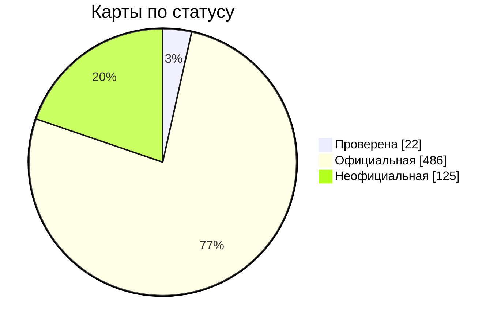

<p align="center">
  <picture>
    <source media="(prefers-color-scheme: dark)" srcset="../../assets/mbmap-logo-white.svg">
    
  </picture>
</p>

# mbmap-library

[English](../../README.md) · [Español](README_ES.md) · [简体中文](README_ZHS.md) · [日本語](README_JP.md) · **Русский**

[](https://github.com/nobrega8/mbmap-library/actions/workflows/validate.yml)
[](../../index.json)
[](../../maps)
[](../../SPEC.md)
[](https://doi.org/10.5281/zenodo.23439922)
[](../../LICENSE)
[](../../CONTRIBUTING.md)
[](https://buymeacoffee.com/nobrega8)

Открытая библиотека карт регистров Modbus в [формате `.mbmap`](../../SPEC.md) — это формат JSON со [схемой JSON Schema](../../schema/mbmap-2.schema.json).

Просматривайте и ищите любые карты, их регистры и настройки подключения на сайте: **[nobrega8.github.io/mbmap-library](https://nobrega8.github.io/mbmap-library/)**.

Каждый файл описывает одну модель устройства: производителя, как к нему подключиться и что означает каждый регистр. Загрузите карту в совместимый инструмент — и вы получите переменные устройства сразу с именами, масштабами и типами, без переписывания адресов из PDF-руководства.

> Это перевод [английского README](../../README.md). Оригинал — английская версия, она может быть актуальнее.

## Структура

```text
SPEC.md                           спецификация формата .mbmap
schema/mbmap-2.schema.json        его JSON Schema
COMPATIBILITY.md                  инструменты, которые читают формат, и что каждый поддерживает
maps/<производитель>/<модель>.mbmap.json  общие карты
examples/                         вымышленные карты, показывающие формат
index.json                        список карт для приложений, которые просматривают библиотеку
tools/                            валидатор, генератор индекса и другие скрипты (см. tools/README.md)
tests/                            образцы файлов и диагностика, которую каждый из них должен вызывать,
                                  для проверки любого читателя .mbmap по спецификации
```

Имена папок и файлов — слаги в нижнем регистре, например `maps/acme-meters/pm-200.mbmap.json`.

## Статус карт

Карты этой библиотеки сообщают в `x_status`, насколько им можно доверять. Этот ключ не входит в формат mbmap — это необязательный ключ, который читают эта библиотека и Modbench:

- **`verified`** (проверена): протестирована на реальном устройстве.
- **`official`** (официальная): написана по документации производителя (указана в `source`), но пока не протестирована на устройстве.
- **`unofficial`** (неофициальная): скопирована из неофициального источника и не протестирована. Большая часть библиотеки была **перенесена из других открытых каталогов** таблиц Modbus, чтобы все могли начать. Ещё никто не сверил их с документацией производителя, и некоторые детали (порядок байтов, область регистров, масштабирование) могут быть неверны. Воспринимайте их как черновик и проверяйте значение на реальном устройстве, прежде чем полагаться на остальное.

<!-- status-chart:start -->

<!-- status-chart:end -->

Протестировали карту на своём устройстве? Сообщите нам через pull request или [отчёт о тесте](https://github.com/nobrega8/mbmap-library/issues/new?template=1-test-report.yml), даже если вы не автор карты.

Исправления — самый полезный вклад: см. [CONTRIBUTING.md](../../CONTRIBUTING.md). Вопросы и идеи — в [Discussions](https://github.com/nobrega8/mbmap-library/discussions).

## Как пользоваться картами

Карта — это файл JSON с одним регистром на строку, поэтому она хорошо читается в любом текстовом редакторе, и любой язык может загрузить её своим JSON-парсером; редакторы с поддержкой JSON Schema проверяют файл прямо при вводе.

[COMPATIBILITY.md](../../COMPATIBILITY.md) перечисляет инструменты, которые читают этот формат, и какие его части каждый поддерживает. Главный из них — [Modbench](https://github.com/nobrega8/modbench), Modbus-клиент для Windows, Linux и macOS, который напрямую просматривает и скачивает карты из этого репозитория. [ScanBus-BR](https://github.com/ortegahernandes/ScanBus-BR-Simulator-Modbus), симулятор и сниффер Modbus для Windows и Linux, тоже умеет искать по библиотеке, а [MTUI](https://github.com/inowattio/MTUI), терминальный Modbus-клиент, импортирует вставленную карту как регистры с именами и расшифрованными значениями.

Создаёте инструмент, читающий `.mbmap`? Следуйте [SPEC.md](../../SPEC.md), проверьте его на образцах из [`tests/`](../../tests/) и откройте pull request, чтобы добавить его в [COMPATIBILITY.md](../../COMPATIBILITY.md). Работа в процессе приветствуется в [Show and tell](https://github.com/nobrega8/mbmap-library/discussions/categories/show-and-tell).

## Бейдж

Инструмент, который читает файлы `.mbmap`, может сообщить об этом этим бейджем, который ведёт сюда:

[![Compatible with .mbmap](https://img.shields.io/badge/compatible-.mbmap-0A7EA4?logo=data:image/svg%2bxml;base64,PHN2ZyB4bWxucz0iaHR0cDovL3d3dy53My5vcmcvMjAwMC9zdmciIHZpZXdCb3g9IjAgMCAyNCAyNCIgZmlsbD0iI2ZmZmZmZiIgZmlsbC1ydWxlPSJldmVub2RkIj4KICA8dGl0bGU+bWJtYXA8L3RpdGxlPgogIDxnIHRyYW5zZm9ybT0idHJhbnNsYXRlKDAgLTAuNTUpIj4KICAgIDxyZWN0IHg9IjEuNDUiIHk9IjUuMyIgd2lkdGg9IjIuNiIgaGVpZ2h0PSIyLjYiIHJ4PSIwLjUiLz4KICAgIDxyZWN0IHg9IjUuOTUiIHk9IjUuMyIgd2lkdGg9IjIuNiIgaGVpZ2h0PSIyLjYiIHJ4PSIwLjUiLz4KICAgIDxyZWN0IHg9IjEwLjQ1IiB5PSI1LjMiIHdpZHRoPSIyLjYiIGhlaWdodD0iMi42IiByeD0iMC41Ii8+CiAgICA8cGF0aCBkPSJNMS41NSAxOS4zVjEyLjQ1QTMuNDUgMy40NSAwIDAgMSA3LjI1IDkuODM1QTMuNDUgMy40NSAwIDAgMSAxMi45NSAxMi40NVYxOS4zYTAuNSAwLjUgMCAwIDEtMC41IDAuNUgxMS4wNWEwLjUgMC41IDAgMCAxLTAuNS0wLjVWMTIuNDVBMS4wNSAxLjA1IDAgMCAwIDguNDUgMTIuNDVWMTkuM2EwLjUgMC41IDAgMCAxLTAuNSAwLjVINi41NWEwLjUgMC41IDAgMCAxLTAuNS0wLjVWMTIuNDVBMS4wNSAxLjA1IDAgMCAwIDMuOTUgMTIuNDVWMTkuM2EwLjUgMC41IDAgMCAxLTAuNSAwLjVIMi4wNWEwLjUgMC41IDAgMCAxLTAuNS0wLjVaIi8+CiAgICA8cGF0aCBkPSJNMTUuMDUgNS44YTAuNSAwLjUgMCAwIDEgMC41LTAuNUgxNi45NWEwLjUgMC41IDAgMCAxIDAuNSAwLjVWOUgxOUEzLjQ1IDMuNDUgMCAwIDEgMjIuNDUgMTIuNDVWMTYuMzVBMy40NSAzLjQ1IDAgMCAxIDE5IDE5LjhIMTUuNTVhMC41IDAuNSAwIDAgMS0wLjUtMC41Wk0xNy40NSAxMS40VjE3LjRIMTlBMS4wNSAxLjA1IDAgMCAwIDIwLjA1IDE2LjM1VjEyLjQ1QTEuMDUgMS4wNSAwIDAgMCAxOSAxMS40WiIvPgogIDwvZz4KPC9zdmc+Cg==)](https://github.com/nobrega8/mbmap-library)

```markdown
[![Compatible with .mbmap](https://img.shields.io/badge/compatible-.mbmap-0A7EA4?logo=data:image/svg%2bxml;base64,PHN2ZyB4bWxucz0iaHR0cDovL3d3dy53My5vcmcvMjAwMC9zdmciIHZpZXdCb3g9IjAgMCAyNCAyNCIgZmlsbD0iI2ZmZmZmZiIgZmlsbC1ydWxlPSJldmVub2RkIj4KICA8dGl0bGU+bWJtYXA8L3RpdGxlPgogIDxnIHRyYW5zZm9ybT0idHJhbnNsYXRlKDAgLTAuNTUpIj4KICAgIDxyZWN0IHg9IjEuNDUiIHk9IjUuMyIgd2lkdGg9IjIuNiIgaGVpZ2h0PSIyLjYiIHJ4PSIwLjUiLz4KICAgIDxyZWN0IHg9IjUuOTUiIHk9IjUuMyIgd2lkdGg9IjIuNiIgaGVpZ2h0PSIyLjYiIHJ4PSIwLjUiLz4KICAgIDxyZWN0IHg9IjEwLjQ1IiB5PSI1LjMiIHdpZHRoPSIyLjYiIGhlaWdodD0iMi42IiByeD0iMC41Ii8+CiAgICA8cGF0aCBkPSJNMS41NSAxOS4zVjEyLjQ1QTMuNDUgMy40NSAwIDAgMSA3LjI1IDkuODM1QTMuNDUgMy40NSAwIDAgMSAxMi45NSAxMi40NVYxOS4zYTAuNSAwLjUgMCAwIDEtMC41IDAuNUgxMS4wNWEwLjUgMC41IDAgMCAxLTAuNS0wLjVWMTIuNDVBMS4wNSAxLjA1IDAgMCAwIDguNDUgMTIuNDVWMTkuM2EwLjUgMC41IDAgMCAxLTAuNSAwLjVINi41NWEwLjUgMC41IDAgMCAxLTAuNS0wLjVWMTIuNDVBMS4wNSAxLjA1IDAgMCAwIDMuOTUgMTIuNDVWMTkuM2EwLjUgMC41IDAgMCAxLTAuNSAwLjVIMi4wNWEwLjUgMC41IDAgMCAxLTAuNS0wLjVaIi8+CiAgICA8cGF0aCBkPSJNMTUuMDUgNS44YTAuNSAwLjUgMCAwIDEgMC41LTAuNUgxNi45NWEwLjUgMC41IDAgMCAxIDAuNSAwLjVWOUgxOUEzLjQ1IDMuNDUgMCAwIDEgMjIuNDUgMTIuNDVWMTYuMzVBMy40NSAzLjQ1IDAgMCAxIDE5IDE5LjhIMTUuNTVhMC41IDAuNSAwIDAgMS0wLjUtMC41Wk0xNy40NSAxMS40VjE3LjRIMTlBMS4wNSAxLjA1IDAgMCAwIDIwLjA1IDE2LjM1VjEyLjQ1QTEuMDUgMS4wNSAwIDAgMCAxOSAxMS40WiIvPgogIDwvZz4KPC9zdmc+Cg==)](https://github.com/nobrega8/mbmap-library)
```

## Участие

Новые карты и исправления приветствуются. Прочитайте [CONTRIBUTING.md](../../CONTRIBUTING.md), а затем проверьте свой файл:

```sh
python tools/validate/validate.py maps/your-vendor/your-model.mbmap.json
```

## Участники

Спасибо всем, кто добавил или исправил карту.

<table>
  <tr>
    <td align="center"><a href="https://github.com/nobrega8"><br /><sub>Afonso Nóbrega</sub></a></td>
    <td align="center"><a href="https://github.com/ortegahernandes"><br /><sub>Rodrigo Hernandes</sub></a></td>
    <td align="center"><a href="https://github.com/marcosribeirobr"><br /><sub>Marcos Ribeiro</sub></a></td>
    <td align="center"><a href="https://github.com/NickHardy-Spotlight"><br /><sub>NickHardy-Spotlight</sub></a></td>
    <td align="center"><a href="https://github.com/CosminPerRam"><br /><sub>CosminPerRam</sub></a></td>
  </tr>
</table>

В этот список входят и те, кто указан в трейлере `Co-authored-by`, который граф участников GitHub не учитывает.

## Лицензия

Карты, спецификация и инструменты переданы в общественное достояние под [CC0 1.0](../../LICENSE). Вы можете использовать их для любых целей, включая коммерческие продукты, без запроса разрешения и указания авторства.

Карты предоставляются «как есть». Всегда сверяйте карту с документацией производителя, прежде чем записывать данные в работающее устройство.

## Поддержка проекта

Библиотека свободна и находится в общественном достоянии. Если она экономит вам время, вы можете поддержать её развитие на Buy Me a Coffee:

<a href="https://buymeacoffee.com/nobrega8"></a>
