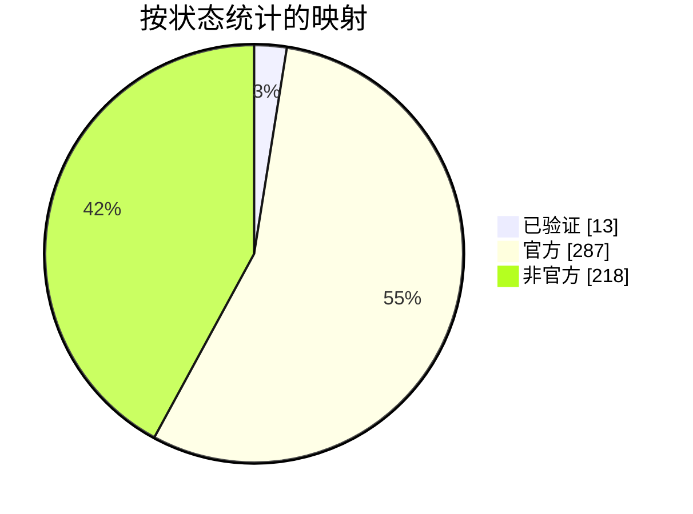

<p align="center">
  <picture>
    <source media="(prefers-color-scheme: dark)" srcset="../../assets/mbmap-logo-white.svg">
    
  </picture>
</p>

# mbmap-library

[English](../../README.md) · [Español](README_ES.md) · **简体中文** · [日本語](README_JP.md)

[](https://github.com/nobrega8/mbmap-library/actions/workflows/validate.yml)
[](../../index.json)
[](../../maps)
[](../../SPEC.md)
[](https://doi.org/10.5281/zenodo.23439922)
[](../../LICENSE)
[](../../CONTRIBUTING.md)
[](https://buymeacoffee.com/nobrega8)

一个开放的 Modbus 寄存器映射库，采用 [`.mbmap` 格式](../../SPEC.md)。该格式基于 JSON，并有对应的 [JSON Schema](../../schema/mbmap-2.schema.json)。

可在网站上浏览和搜索所有映射、它们的寄存器和连接设置：**[nobrega8.github.io/mbmap-library](https://nobrega8.github.io/mbmap-library/)**。

每个文件描述一种设备型号：厂商、连接方式，以及每个寄存器的含义。把映射载入兼容的工具后，就能得到设备的各个变量，已命名、已换算、已定类型，无需再从 PDF 手册里抄地址。

> 这是[英文 README](../../README.md) 的翻译。英文版为准，可能更新。

## 目录结构

```text
SPEC.md                           .mbmap 格式规范
schema/mbmap-2.schema.json        对应的 JSON Schema
COMPATIBILITY.md                  能读取该格式的工具，以及各自支持的内容
maps/<厂商>/<型号>.mbmap.json      共享的映射
examples/                         演示格式的虚构映射
index.json                        映射列表，供浏览本库的应用使用
tools/                            校验器、索引生成器等脚本（见 tools/README.md）
tests/                            示例文件及各自应产生的诊断结果，
                                  用于对照规范检查任何 .mbmap 读取器
```

文件夹和文件名都是小写的 slug，例如 `maps/acme-meters/pm-200.mbmap.json`。

## 映射状态

本库中的映射通过 `x_status` 说明其可信程度。它不属于 mbmap 格式，只是本库和 Modbench 会读取的一个可选键：

- **`verified`**（已验证）：已在真实设备上测试。
- **`official`**（官方）：根据厂商文档（见 `source`）编写，但尚未在设备上测试。
- **`unofficial`**（非官方）：复制自非官方来源，未经测试。本库的很大一部分是为了让大家有个起点，**从其他开放的 Modbus 表目录转换而来**。目前还没有人对照厂商文档核对过，部分细节（字节序、寄存器区域、缩放）可能有误。请把它们当作草稿，在依赖其余内容之前先在真实设备上核对一个值。

<!-- status-chart:start -->

<!-- status-chart:end -->

在你的设备上测试过某个映射？请通过 pull request 或[测试报告](https://github.com/nobrega8/mbmap-library/issues/new?template=1-test-report.yml)告诉我们，即使映射不是你写的。

修正是最有价值的贡献：见 [CONTRIBUTING.md](../../CONTRIBUTING.md)。问题和想法请发到 [Discussions](https://github.com/nobrega8/mbmap-library/discussions)。

## 使用映射

映射是每行一个寄存器的 JSON 文件，因此在任何文本编辑器里都便于阅读，任何语言都可以用自带的 JSON 解析器加载；支持 JSON Schema 的编辑器会在你输入时进行检查。

[COMPATIBILITY.md](../../COMPATIBILITY.md) 列出了能读取该格式的工具，以及各自支持的部分。主要的一个是 [Modbench](https://github.com/nobrega8/modbench)，一款适用于 Windows、Linux 和 macOS 的 Modbus 客户端，可直接浏览并下载本仓库中的映射。[ScanBus-BR](https://github.com/ortegahernandes/ScanBus-BR-Simulator-Modbus) 是适用于 Windows 和 Linux 的 Modbus 模拟器和嗅探器，同样可以搜索本库；[MTUI](https://github.com/inowattio/MTUI) 是终端里的 Modbus 客户端，可以把粘贴的映射导入为带标签、已解码的寄存器。

正在开发读取 `.mbmap` 的工具？请遵循 [SPEC.md](../../SPEC.md)，用 [`tests/`](../../tests/) 中的示例检查，并提交 pull request，把它加入 [COMPATIBILITY.md](../../COMPATIBILITY.md)。欢迎把进行中的工作发到 [Show and tell](https://github.com/nobrega8/mbmap-library/discussions/categories/show-and-tell)。

## 徽章

能读取 `.mbmap` 文件的工具可以使用这个徽章来表明，它链接到本仓库：

[![Supports .mbmap](https://img.shields.io/badge/supports-.mbmap-0A7EA4?logo=data:image/svg%2bxml;base64,PHN2ZyB4bWxucz0iaHR0cDovL3d3dy53My5vcmcvMjAwMC9zdmciIHZpZXdCb3g9IjAgMCAyNCAyNCIgZmlsbD0iI2ZmZmZmZiIgZmlsbC1ydWxlPSJldmVub2RkIj4KICA8dGl0bGU+bWJtYXA8L3RpdGxlPgogIDxnIHRyYW5zZm9ybT0idHJhbnNsYXRlKDAgLTAuNTUpIj4KICAgIDxyZWN0IHg9IjEuNDUiIHk9IjUuMyIgd2lkdGg9IjIuNiIgaGVpZ2h0PSIyLjYiIHJ4PSIwLjUiLz4KICAgIDxyZWN0IHg9IjUuOTUiIHk9IjUuMyIgd2lkdGg9IjIuNiIgaGVpZ2h0PSIyLjYiIHJ4PSIwLjUiLz4KICAgIDxyZWN0IHg9IjEwLjQ1IiB5PSI1LjMiIHdpZHRoPSIyLjYiIGhlaWdodD0iMi42IiByeD0iMC41Ii8+CiAgICA8cGF0aCBkPSJNMS41NSAxOS4zVjEyLjQ1QTMuNDUgMy40NSAwIDAgMSA3LjI1IDkuODM1QTMuNDUgMy40NSAwIDAgMSAxMi45NSAxMi40NVYxOS4zYTAuNSAwLjUgMCAwIDEtMC41IDAuNUgxMS4wNWEwLjUgMC41IDAgMCAxLTAuNS0wLjVWMTIuNDVBMS4wNSAxLjA1IDAgMCAwIDguNDUgMTIuNDVWMTkuM2EwLjUgMC41IDAgMCAxLTAuNSAwLjVINi41NWEwLjUgMC41IDAgMCAxLTAuNS0wLjVWMTIuNDVBMS4wNSAxLjA1IDAgMCAwIDMuOTUgMTIuNDVWMTkuM2EwLjUgMC41IDAgMCAxLTAuNSAwLjVIMi4wNWEwLjUgMC41IDAgMCAxLTAuNS0wLjVaIi8+CiAgICA8cGF0aCBkPSJNMTUuMDUgNS44YTAuNSAwLjUgMCAwIDEgMC41LTAuNUgxNi45NWEwLjUgMC41IDAgMCAxIDAuNSAwLjVWOUgxOUEzLjQ1IDMuNDUgMCAwIDEgMjIuNDUgMTIuNDVWMTYuMzVBMy40NSAzLjQ1IDAgMCAxIDE5IDE5LjhIMTUuNTVhMC41IDAuNSAwIDAgMS0wLjUtMC41Wk0xNy40NSAxMS40VjE3LjRIMTlBMS4wNSAxLjA1IDAgMCAwIDIwLjA1IDE2LjM1VjEyLjQ1QTEuMDUgMS4wNSAwIDAgMCAxOSAxMS40WiIvPgogIDwvZz4KPC9zdmc+Cg==)](https://github.com/nobrega8/mbmap-library)

```markdown
[![Supports .mbmap](https://img.shields.io/badge/supports-.mbmap-0A7EA4?logo=data:image/svg%2bxml;base64,PHN2ZyB4bWxucz0iaHR0cDovL3d3dy53My5vcmcvMjAwMC9zdmciIHZpZXdCb3g9IjAgMCAyNCAyNCIgZmlsbD0iI2ZmZmZmZiIgZmlsbC1ydWxlPSJldmVub2RkIj4KICA8dGl0bGU+bWJtYXA8L3RpdGxlPgogIDxnIHRyYW5zZm9ybT0idHJhbnNsYXRlKDAgLTAuNTUpIj4KICAgIDxyZWN0IHg9IjEuNDUiIHk9IjUuMyIgd2lkdGg9IjIuNiIgaGVpZ2h0PSIyLjYiIHJ4PSIwLjUiLz4KICAgIDxyZWN0IHg9IjUuOTUiIHk9IjUuMyIgd2lkdGg9IjIuNiIgaGVpZ2h0PSIyLjYiIHJ4PSIwLjUiLz4KICAgIDxyZWN0IHg9IjEwLjQ1IiB5PSI1LjMiIHdpZHRoPSIyLjYiIGhlaWdodD0iMi42IiByeD0iMC41Ii8+CiAgICA8cGF0aCBkPSJNMS41NSAxOS4zVjEyLjQ1QTMuNDUgMy40NSAwIDAgMSA3LjI1IDkuODM1QTMuNDUgMy40NSAwIDAgMSAxMi45NSAxMi40NVYxOS4zYTAuNSAwLjUgMCAwIDEtMC41IDAuNUgxMS4wNWEwLjUgMC41IDAgMCAxLTAuNS0wLjVWMTIuNDVBMS4wNSAxLjA1IDAgMCAwIDguNDUgMTIuNDVWMTkuM2EwLjUgMC41IDAgMCAxLTAuNSAwLjVINi41NWEwLjUgMC41IDAgMCAxLTAuNS0wLjVWMTIuNDVBMS4wNSAxLjA1IDAgMCAwIDMuOTUgMTIuNDVWMTkuM2EwLjUgMC41IDAgMCAxLTAuNSAwLjVIMi4wNWEwLjUgMC41IDAgMCAxLTAuNS0wLjVaIi8+CiAgICA8cGF0aCBkPSJNMTUuMDUgNS44YTAuNSAwLjUgMCAwIDEgMC41LTAuNUgxNi45NWEwLjUgMC41IDAgMCAxIDAuNSAwLjVWOUgxOUEzLjQ1IDMuNDUgMCAwIDEgMjIuNDUgMTIuNDVWMTYuMzVBMy40NSAzLjQ1IDAgMCAxIDE5IDE5LjhIMTUuNTVhMC41IDAuNSAwIDAgMS0wLjUtMC41Wk0xNy40NSAxMS40VjE3LjRIMTlBMS4wNSAxLjA1IDAgMCAwIDIwLjA1IDE2LjM1VjEyLjQ1QTEuMDUgMS4wNSAwIDAgMCAxOSAxMS40WiIvPgogIDwvZz4KPC9zdmc+Cg==)](https://github.com/nobrega8/mbmap-library)
```

## 参与贡献

欢迎提交新映射和修正。请先阅读 [CONTRIBUTING.md](../../CONTRIBUTING.md)，然后检查你的文件：

```sh
python tools/validate/validate.py maps/your-vendor/your-model.mbmap.json
```

## 贡献者

感谢所有添加或修正过映射的人。

<table>
  <tr>
    <td align="center"><a href="https://github.com/nobrega8"><br /><sub>Afonso Nóbrega</sub></a></td>
    <td align="center"><a href="https://github.com/ortegahernandes"><br /><sub>Rodrigo Hernandes</sub></a></td>
    <td align="center"><a href="https://github.com/marcosribeirobr"><br /><sub>Marcos Ribeiro</sub></a></td>
    <td align="center"><a href="https://github.com/NickHardy-Spotlight"><br /><sub>NickHardy-Spotlight</sub></a></td>
    <td align="center"><a href="https://github.com/CosminPerRam"><br /><sub>CosminPerRam</sub></a></td>
  </tr>
</table>

此列表也包含在提交中以 `Co-authored-by` 署名的人，GitHub 的贡献者图表不会统计他们。

## 许可证

映射、规范和工具均依据 [CC0 1.0](../../LICENSE) 贡献到公有领域。你可以将它们用于任何用途，包括商业产品，无需征得同意，也无需署名。

映射按“现状”提供。向正在运行的设备写入之前，请务必对照厂商文档检查映射。

## 资助

本库是自由的，属于公有领域。如果它为你节省了时间，可以在 Buy Me a Coffee 上支持它的开发：

<a href="https://buymeacoffee.com/nobrega8"></a>
